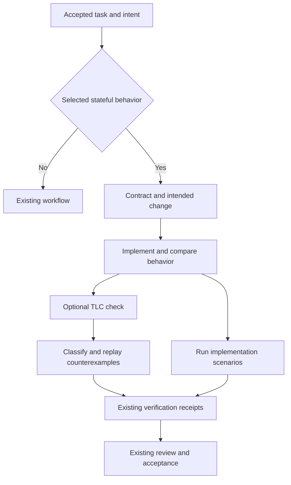

# Agent Kit behavior verification PRD

**Status:** Proposed v1 requirements and implementation backlog  
**Date:** 5 November 2026  
**Repository baseline:** `Pibomeister/agent-kit`, `main` at `2fe67bdc6acca234e0930fd442db82971562e28c`, package version `0.1.95`  
**Companion:** `agent-kit-behavior-verification-test-plan.md`

## 1. Product decision

Add a bounded behavior-verification capability to Agent Kit's existing build, review, and verification workflow. For selected stateful changes, agents will make intended behavior explicit, compare it with implemented behavior, execute relevant event sequences, and optionally check a small TLA+ model. Every result must retain its scope and connect to the existing evidence and acceptance machinery.

The intended outcome is a higher rate of usable changes that satisfy the user's requirements, with clearer review of consequential behavior. More diagrams, more generated tests, and more passing checker output are not success measures by themselves.

This proposal contains five capability additions, delivered through eight bounded work items. It preserves the current lifecycle, ownership of project artifacts, independent verifier rules, and existing review and shipping authority. The numerical rollout thresholds below are proposed experiment decisions to freeze before evaluation; they are not measured results or universal engineering rules.

### Five additions

| ID | Improvement | New result | Existing machinery reused |
|---|---|---|---|
| BV-1 | Intent-backed behavior contracts | A small contract with source-backed requirements, states, events, properties, and assumptions | Approved work sources, ticket acceptance criteria, artifact references, central KB |
| BV-2 | Behavioral change review | A compact account of added or removed transitions, changed guards/effects, altered assumptions, and unresolved correspondence | Existing correctness/spec seats, immutable review snapshots, affected-behavior delta review |
| BV-3 | Executable behavior evidence | Selected adverse event sequences and model counterexamples connected to actual implementation checks | TDD, verification commands/recipes, fast-check, event-sequence harness patterns, independent verifier |
| BV-4 | Optional bounded TLC checking | A normalized, reproducible result for one supplied finite model and configuration | Existing process execution, command receipts, CLI packaging and toolchain identity |
| BV-5 | Enforcement of behavioral evidence bindings | Existing acceptance rejects missing, stale, incomplete, or misapplied behavior evidence for explicitly required checks | Verification schema, lifecycle predicate, run records, existing invalidation and weakened-check decisions |

### Release boundary

- One new semantic artifact schema: `behavior-contract`.
- One shared reference pack for behavior verification; no new public skill, lifecycle phase, permanent reviewer seat, or protocol.
- One proposed low-level CLI command: `ak behavior-check`, dedicated to the supported TLC path.
- Additive integration in existing ticket, review, verification, project, artifact-registry, and run-policy structures.
- One initial product model: acceptance of verification evidence after relevant inputs change.
- One small liveness fixture to validate temporal-property support in the tool adapter. It is not a second product model.
- Flat contract charts or transition tables, plus counterexample views. Hierarchical and parallel chart tooling is deferred.
- Live output evaluation on one primary host and a six-task transfer subset on a second host; packaging regression checks on all six currently packaged hosts.
- One small experiment coordinator using the existing case-runner's dependency hooks to select an arm's bundle, retain delivered changes, and attach independent execution results; no new evaluation framework.
- At most 104 measured subject sessions in the initial experiment. Grading, calibration, preflight, and infrastructure retries are separately reported and budgeted.

The release can be installed with the feature off and exercised in shadow mode before it qualifies for limited required use. A broad default rollout is outside v1.

## 2. Problem and users

Agent Kit already asks agents to produce evidence and independent review. A remaining failure mode is semantic agreement around an incorrect interpretation: the implementation, its tests, and its explanation can all reproduce the same omitted requirement or favorable assumption.

Stateful changes make that failure particularly expensive. Retries, cancellation, ownership, delayed events, and effects that cross transaction boundaries can be individually plausible while producing incorrect behavior in a particular order. Reviewers need to see those orders and the decisions they embody without reconstructing them from a large diff.

The primary users are the implementer, the existing correctness/spec reviewer, the independent verifier, and the person responsible for the product's behavior. Implementers need a stable target. Reviewers need a concise behavioral difference with source links. Verifiers need concrete claims and executable checks. The product owner should review material intent decisions and unresolved ambiguity; the feature must not transfer routine reproduction and QA work to that person.

### Outcome hypotheses

1. Contracts grounded in accepted intent reduce omitted or invented behavior.
2. Explicit event and assumption review catches errors that ordinary diff review misses.
3. Model counterexamples and adverse event sequences produce useful implementation regressions.
4. Scope-aware evidence prevents a model pass from being mistaken for implementation or product acceptance.
5. Reviewers can make correct decisions with less effort when the behavioral difference is accurate and compact.

Each hypothesis needs its own evidence. Mechanism tests establish implementation conformance; the paired experiment establishes observed output effects; a separate review exercise establishes human review benefit.

## 3. Baseline and integration map

The baseline already contains the following capabilities. They are regression obligations, not new benefits to attribute to this feature. Source links are pinned to the inspected revision.

| Existing surface | Existing behavior | v1 extension |
|---|---|---|
| [super-build](https://github.com/Pibomeister/agent-kit/blob/2fe67bdc6acca234e0930fd442db82971562e28c/skills/super-build/SKILL.md) | Approved ticket, owned worktree, implementation checks, separate review seats, handoff to independent verification | Load a selected contract, identify intended behavioral change, and supply mapped claims to the existing verifier handoff |
| [super-review](https://github.com/Pibomeister/agent-kit/blob/2fe67bdc6acca234e0930fd442db82971562e28c/skills/super-review/SKILL.md) | Immutable snapshots, specialist lanes, affected-behavior deltas, current-evidence readiness | Review the behavioral difference and assumptions in existing correctness/spec work |
| [super-verify](https://github.com/Pibomeister/agent-kit/blob/2fe67bdc6acca234e0930fd442db82971562e28c/skills/super-verify/SKILL.md) | Fresh execution, complete output inspection, receipts per check, independent verification | Interpret model results precisely and execute declared implementation replay |
| [Verification schema](https://github.com/Pibomeister/agent-kit/blob/2fe67bdc6acca234e0930fd442db82971562e28c/schemas/verification.schema.json) | Source revision, command/exit/output digests, recipe hash, environment, seat lineage, invalidation, weakened checks | Add behavior-specific inputs and evidence-layer bindings |
| [Verification reference](https://github.com/Pibomeister/agent-kit/blob/2fe67bdc6acca234e0930fd442db82971562e28c/references/verification-evidence/REFERENCE.md) | Declared runtime facilities and evidence kinds; completion predicate | State the boundary between formal-model and implementation evidence |
| [Lifecycle gate](https://github.com/Pibomeister/agent-kit/blob/2fe67bdc6acca234e0930fd442db82971562e28c/src/lifecycle/gate.ts) | Shape validation and evidence eligibility/coverage checks | Enforce opted-in behavior obligations in the same predicate |
| [Event-sequence tests](https://github.com/Pibomeister/agent-kit/blob/2fe67bdc6acca234e0930fd442db82971562e28c/tests/event-sequences/event-sequences.test.ts) | Reference model, implementation adapter, generated sequences, shrinking/replay, regression corpus, fault-injection controls | Reuse patterns and compatible events; add a narrowly scoped actual-gate adapter if simpler than expanding the existing broad model |
| [Case runner](https://github.com/Pibomeister/agent-kit/blob/2fe67bdc6acca234e0930fd442db82971562e28c/tests/learn/evals/case-runner.ts) | Cross-host case execution, grader panels, budget scheduling, explicit incomplete outcomes | Use its dependency hooks for separate bundle selection, complete change capture, and trusted executable acceptance oracles |

`protocols/evidence-gate/PROTOCOL.md` governs admission to learning ledgers. It is not the implementation verification gate and is not an integration target for this feature.

The event-sequence adapter distinguishes actual runner calls from document changes checked by validators. The new replay must retain that distinction. Existing regression corpus entries include an explicitly expected disagreement; their presence does not mean all lifecycle behavior is proved or that the baseline test command fails.

## 4. Non-goals

The following are excluded from v1:

- A new orchestration or supervision layer; task ownership stays with its existing owner.
- A generic formal-verification plugin framework, or Lean, Dafny, CBMC, Kani, or automatic refinement-proof integrations.
- Automatic conversion of arbitrary code into a trusted specification.
- Formal models of every Agent Kit policy or every application workflow.
- A mandatory diagram, formal checker, or additional reviewer for every PR.
- A second evidence store, completion gate, issue tracker, or semantic source of truth.
- A generic cross-language replay engine or a replacement for the current event-sequence/eval tools.
- New live host adapters, model routing, provider selection, pricing tables, or effort selection in canonical instructions.
- Automatic Java/TLC installation or expanding resource limits until a check completes.
- Claims of bug-free software, verified product intent, arbitrary deployment-size correctness, or universal liveness.
- Changing existing merge, deployment, authority, isolation, or independent-verifier rules.

New scopes require a separate decision after the pilot results. They cannot be absorbed into the last implementation ticket as cleanup.

## 5. Eligibility and operating modes

### 5.1 Select changes by behavior

The existing workflow records a short applicability decision using the request, accepted ticket, and affected code. Eligible changes introduce or alter meaningful lifecycle transitions, guards, side effects, ordering, retries, cancellation, duplicate handling, ownership, finalization, or recovery.

Copy edits, formatting, presentation-only changes, and straightforward stateless changes normally take the existing path. A path name, keyword, changed-line count, or model confidence score cannot independently establish eligibility. Semantic selection is an agent judgment with cited evidence, subject to existing review.

The first required pilot selects its scope explicitly. Automatic code-wide state-machine discovery is not a release dependency.

### 5.2 Proposed project setting

Add `review.behavior: off | shadow | on`, defaulting to `off` for existing projects.

| Mode | Behavior | Acceptance effect |
|---|---|---|
| off | No behavior-specific workflow is started | Existing semantics remain intact |
| shadow | Produce applicable contracts/deltas/checks within a declared budget; preserve results | New feature output cannot change the current gate or satisfy a missing required check |
| on | Use behavior work within the existing build/review/verify workflow | Only named mandatory checks/constraints and ordinary adjudicated findings can block, using existing policy |

In shadow mode, retain normalized results as ordinary run artifacts linked from the report. Do not submit them as gate-evidence references or let them satisfy required checks. This matters because an ordinary current failed receipt supporting an acceptance criterion already affects the existing gate. If a shadow observation reveals a real implementation defect, promote that defect through the existing finding/verification process and its ordinary authority; shadow mode does not suppress independently confirmed defects.

`on` does not make TLC universal or silently promote every advisory property to a release gate. Projects declare actual obligations through the existing mandatory-constraint and named ticket-check mechanisms. A required formal check without the configured tool remains unmet. A voluntary check without the tool is reported as not run while other authorized verification continues.

Modes cannot cancel previously required checks. An advisory-mode setting that conflicts with an explicit mandatory behavior obligation is a configuration conflict requiring the existing authorized resolution path, not permission to omit the check.

### 5.3 Bind policy when a task-bound run opens

The caller resolves the authoritative project and task binding using existing KB/runner facilities. The run stores the effective behavior mode, policy identity/hash, and immutable references/digests for complete required-check definitions with its immutable inputs. Definitions include check identity, evidence layer, property IDs/types, expected contract/input bindings, and existing surface/runtime requirements. IDs alone are insufficient: editing a ticket under the same check ID cannot change the meaning of the run's obligation. Resume, delegated, standalone, and unattended paths consume that recorded policy consistently.

A failed lookup must not turn an enabled run into `off`. Editing the ticket's project field must not move a current required run into a legacy exemption. A deliberate policy change uses the existing authorized update/new-run route and invalidates affected evidence. It is distinct from an unavailable policy source.

Pre-feature runs without behavior bindings retain legacy behavior. A new enabled run with missing bindings is incomplete, not legacy; use the authoritative run format/version and creation record to distinguish them, not a worker's assertion. Preserve the current protected run-storage and lineage boundary. Guided hosts retain their existing evidence ceiling; the local CLI does not acquire a stronger trust claim merely because a policy hash is well formed.

## 6. Functional requirements

### BV-R01 — Ground required behavior in accepted intent

A contract requirement has a stable property ID, a plain-language statement, acceptance-criterion links, and references to its intent source. Accepted sources include the existing approved ticket/work source, accepted requirements, recorded decisions, and explicit user instructions. Evidence from the current implementation can explain observed behavior but cannot by itself establish that the behavior is wanted.

Classify a requirement as accepted, proposed, or unresolved. Existing accepted intent is reused without new approval prompts. Material uncertainty uses the existing decision/escalation path. No agent may resolve a discrepancy by silently changing the requirement to match its implementation.

**Acceptance:** If code retries twice but no accepted source chooses a retry limit, the contract records two retries as observed behavior or a proposal; it does not label that limit accepted.

### BV-R02 — Represent the relevant behavior compactly

For one selected subsystem, record states, events, guards, effects, relevant transitions, scope exclusions, and material assumptions. Produce a flat Mermaid contract view or transition table in the reader's vocabulary. A large view may be reduced, but the report identifies hidden details and preserves the distinctions needed to understand each property and counterexample.

The view is explicitly a contract/model view. Rendering it does not establish correspondence to code or a checker result. No diagram image renderer or graphical editor is required.

### BV-R03 — Separate safety, liveness, and assumptions

Properties identify their kind. A safety claim may be checked as an invariant or an appropriate temporal safety property. A liveness claim requires a temporal property with its environmental/fairness assumptions made visible. The allowed mapping is explicit; the adapter must not count an invariant as evidence for a declared eventuality.

Assumptions record whether they are enforced, observed, or assumed, with supporting references when available. The system does not claim to automatically prove that an assumption is realistic.

### BV-R04 — Compare intended and implemented behavior

The existing review artifact carries a structured behavioral difference linked to immutable code snapshots and contract references. It covers added/removed events and transitions, changed guards, reordered effects, changed recovery or terminal behavior, changed assumptions, and uncertain mappings.

Mechanical comparison identifies structural edits to the contract. Existing independent review interprets code behavior; v1 does not claim a general semantic diff algorithm. An omitted event remains a finding or unresolved gap even if the generated diagram is internally consistent.

### BV-R05 — Map claims to real checks

For each selected property, identify the concrete implementation entry point, the relevant check, and what external behavior is substituted. Preserve actual atomicity boundaries. A modeled single transition spanning separate writes or asynchronous boundaries needs an explicit mapping explanation and an adverse ordering when relevant.

Use the existing named verification checks, recipes where applicable, fast-check dependency, and regression infrastructure. A test of a copied transition function is model evidence; it does not count as a test of production behavior.

### BV-R06 — Reproduce counterexamples with honest classifications

A model counterexample is retained with model inputs, actions, and state observations. When a production defect is claimed, the independent verifier replays the relevant actions through the actual implementation boundary and records that result.

Replay outcomes are confirmed implementation failure, model/mapping mismatch, or unresolved. Failure to reproduce does not erase the model finding or prove production safe. Generic model traces may require a hand-authored adapter; only the initial pilot's declared events have an automatic mapping in v1.

A confirmed implementation replay in v1 requires a finite violation witness, including an explicitly specified deadline when applicable. An unbounded liveness counterexample remains model evidence: observing a finite prefix or several repetitions of a nonprogress cycle cannot establish that the implementation will never progress. Record bounded nonprogress honestly; generic liveness-to-production replay is outside v1.

### BV-R07 — Run one optional TLC path

The proposed `ak behavior-check` command accepts the supplied model/configuration, declared property manifest, tool identity, run resource limits, and output destination. It invokes a locally configured supported TLC/Java toolchain through argument vectors, captures complete tool output, and writes a normalized result and digested artifacts.

It is a tool helper. It cannot create a verifier identity, runner attestation, approval, or gate-eligible receipt on its own. The existing verifier consumes its result and authors the ordinary verification receipt.

Initial support is exhaustive checking of a finite model with explicit property declarations and a reproducible toolchain. Simulation and intentional depth truncation are not exhaustive results. Unsupported tool versions/configuration constructs are explicit inconclusive outcomes. v1 does not silently rewrite constraints, fairness, or a specification to make it finish.

### BV-R08 — Reconcile requested properties and terminal results

Passing requires a recognized complete check of the declared property set, not merely process exit zero. The result records the actual property IDs/types, modeled domains, assumptions/configuration, checker mode, explored-state information where supplied, terminal reason, and bounds/resource consumption.

Missing properties, an empty property set for a required obligation, unrecognized or truncated output, tool errors, process cancellation, timeout, or memory exhaustion cannot become passed. Initial-state satisfiability and an intended valid path have explicit sanity checks in the pilot; this is not a general vacuity prover.

### BV-R09 — Keep model and implementation evidence distinct

Each behavior check declares `model` or `implementation` as its evidence layer. A TLC pass supports only the named model obligation. It cannot satisfy a required screenshot, API response, running-service check, user-path trial, or separate implementation property.

Use the existing command receipt kind. Do not add model output to the current runtime `evidence_kind` vocabulary under a misleading label such as runtime trace. A formal-only obligation can be an acceptance criterion with `surface: none`; existing frontend/backend criteria keep their current surface and evidence requirements.

The lifecycle predicate explicitly enforces the layer and binding for enabled required behavior checks. Optional metadata alone is insufficient: a generic passing command with the same `supports` IDs must not bypass the declared behavior obligation.

### BV-R10 — Bind all claim-affecting inputs

Behavior evidence binds the contract artifact hash, required property set/types, scope/assumptions, implementation mapping, model source and imported modules, TLC configuration, and tool identity. Existing revision/diff, environment, recipe, output, artifact, and seat bindings remain in force.

Materialize the complete resolved model/configuration/module closure and property manifest into an execution snapshot before launch. Invoke TLC against those frozen bytes, protected from concurrent modification through the available runner isolation; preserve the exact contents and digests. Hashing mutable input paths before launching is insufficient. If snapshot integrity cannot be established, the result cannot become passing required evidence. Compare current source/artifact references with that checked snapshot when deciding reuse.

Persist exact inputs or immutable resolvable artifacts whose digests are checked. KB contract changes and scratch model/configuration changes can invalidate a result without a source commit. A content digest without accessible underlying evidence is not enough to satisfy a required check.

### BV-R11 — Preserve changes to promises and coverage

Removing a property, narrowing domains, adding favorable assumptions, changing fairness, or substituting a model-only test for a real implementation check changes the claim. Record the old/new scope and use existing weakening/change decisions where the claim is weakened. A change is not automatically weakening; unclear semantic effects remain reviewable rather than being declared harmless.

Existing findings and failed gate-linked receipts remain visible and immutable. Disabling the feature or replacing a result cannot erase a recorded current failure. Any resolution follows the existing adjudication and superseding-evidence rules. Shadow tool results remain retained run artifacts until an explicit ordinary finding/verification action promotes the relevant claim; retention alone does not insert them into gate evidence.

### BV-R12 — Preserve operational boundaries

No new model routing, host authority, self-approval, public phase, or retry loop is introduced. The current correction limits apply. Resource limits come from the runner/project execution context, not fixed token or dollar caps in canonical skills.

Missing tools or unavailable independent seats remain visible. The feature cannot relabel host-unattested evidence as runner-attested, or replace a missing independent verifier with the author.

### BV-R13 — Preserve artifact ownership and provenance

Publish semantic contracts and review/verification records through the central KB. Executable model modules, fixtures, and replay adapters belong with versioned test assets in their owning repository. Local materializations and tool output are execution scratch referenced by durable artifacts; they do not create a competing repository documentation tree.

Add the artifact registry/schema declarations and KB operation support together. Adapted pstack material requires pinned provenance and license handling; conversation-derived requirements need the repository's legitimate conversation-source anchor. Never fabricate a locator to satisfy the catalog validator.

### BV-R14 — Preserve supported packaging and honest host claims

Source CLI and standalone `ak-gate.mjs` must apply equivalent behavior-evidence predicates. All six packaged hosts retain closed references and correct generated command paths. Cursor's command rewrite must handle `ak behavior-check`.

The initial live evaluation covers Claude Code and Codex only in the stated primary/transfer arrangement. Packaging success for Grok, Kimi, Droid, or Cursor is not live output evidence for those hosts. No new host capability is claimed beyond configured process execution and the existing verifier facilities.

### BV-R15 — Demonstrate improved output separately

The feature is implementation-complete only after its mechanism and regression gates pass. Promotion from shadow to required use additionally needs the frozen paired experiment and the limited rollout gates in section 12. A claim of reduced human review effort additionally needs the real reviewer exercise in the test plan.

## 7. Data and command design

The names in this section are proposed extension points, not existing API promises. Implementation may align names with the repository's conventions while preserving every requirement and test mapping.

### 7.1 Behavior contract artifact

Use the existing artifact envelope and content-addressed references. The new body includes:

| Field group | Required content |
|---|---|
| Identity and scope | Stable subsystem identity, affected surfaces, exclusions, relevant source references |
| Intent provenance | Accepted/proposed/unresolved classification and source references for required behavior |
| Behavioral structure | States, events, transitions, guards, and effects sufficient to understand selected properties |
| Properties | Stable IDs, statement, safety/liveness classification, linked acceptance criteria and intent sources |
| Assumptions | Statement, basis, supporting evidence if available, affected properties |
| Correspondence | Versioned mappings to implementation entry points and declared model/test assets; atomicity notes |
| Limits | What the contract/model omits and what its checks can establish |

Observed implementation behavior is reported separately in the current review/delta, with code references. It cannot silently amend the accepted contract. Reusing an approved contract carries its accepted decisions forward; a new approval ceremony is not added for unchanged intent.

### 7.2 Ticket and review extensions

Tickets can reference selected contracts and record an applicability decision. A named verification check can bind a contract, property IDs, evidence layer, and expected input manifest. The run's immutable policy binding preserves the complete selected definition, including existing acceptance-surface requirements. Acceptance resolves against that definition until an authorized update invalidates affected evidence. Existing acceptance criteria and named checks remain the unit consumed by the gate.

The existing review artifact gains an optional behavioral-delta section: contract references, old/new state or transition identifiers, category of change, code evidence, affected property IDs, and unresolved correspondence. A compact summary points to the detailed evidence rather than copying the entire contract into every review.

### 7.3 Verification extension

Add a structured `behavior` block to the existing verification schema. It contains the contract reference, property set and types, evidence layer, normalized result reference/digest, input-manifest digest, and replay relationship when present. Formal results additionally identify model/configuration/module/tool digests and complete/violated/incomplete status details.

Existing fields retain their meaning: `kind`, `command`, `exit_status`, `output_digest`, `artifacts`, `source_revision`, `environment`, `supports`, `verifier_seat`, and `invalidation`. Narratives remain non-evidence. Old receipts remain valid for old checks; they do not automatically satisfy new opted-in requirements.

The normalizer/result format can be a tool-output type validated within the command's code. It is not a second top-level semantic artifact or an alternate acceptance system.

### 7.4 Proposed command behavior

`ak behavior-check` performs only TLC execution, input capture, result normalization, and production of text/Mermaid views from declared inputs or counterexamples. It does not discover product intent, choose a provider, install tools, mutate the product, or issue approvals.

Arguments use explicit paths or materialized artifact inputs; tool invocation uses an argument vector against the frozen execution snapshot. Pin the supported TLC/Java identity in the execution configuration and freeze it in test receipts. The complete input identity includes imported module dependencies, not just the top-level `.tla` file. Preserve complete logs; a captured-output limit that truncates evidence makes the run inconclusive.

Wall-time and memory limits bound the process. If a state-exploration cap is added, reaching it aborts with incomplete status; it must not be implemented as a hidden state constraint followed by a claimed complete result. Cleanup removes owned scratch/processes without deleting source inputs or unrelated files.

### 7.5 Status mapping

| Tool observation | Existing receipt status | Eligibility |
|---|---|---|
| Recognized complete run, every declared property reconciled and satisfied | passed | May support its exact model obligation |
| Counterexample or declared property violation | failed | Preserved as model evidence; real-code defect classification requires mapping/replay |
| Started but interrupted, resource-limited, unsupported/unparseable, or incomplete | inconclusive | Cannot satisfy required evidence |
| Required tool or permitted facility unavailable before execution | not-run | Cannot satisfy required evidence |
| Behavior/check genuinely outside the recorded scope | not-applicable | Does not count as a pass; cannot be chosen to avoid a predeclared required obligation |

Raw exit status stays raw. Existing `exit_disagreement` handles a zero exit whose output reports failure. A completed formal result plus a failed implementation test yields a failed implementation obligation; the model pass cannot override it.

## 8. Workflow integration



Before contract lock, use accepted intent to identify important states, user decisions, effects, and recovery. During `super-build`, execute the approved change and targeted tests, then supply fresh bindings to the independent verifier. During `super-review`, compare the intended behavioral change with the immutable patch and identify omitted behavior or unsupported assumptions. During `super-verify`, run the declared implementation and model checks and record separate evidence layers.

After repeated test failure, use the event sequence and correspondence to investigate the cause within the existing retry limit. Do not reset the fix budget by switching from a test to a model or renaming the failure.

The final acceptance uses the current revision after all transformations. If Nativize or another refactor changes relevant code, the normal invalidation and re-verification apply. This proposal does not depend on Nativize having shipped.

## 9. Initial formal and empirical pilot

### 9.1 Narrow subject

Model whether an existing required behavior obligation can be accepted using evidence that no longer matches its current inputs. The implementation boundary is the actual lifecycle evidence predicate/CLI, not a new implementation of the policy inside a test.

Represent a small finite set of source snapshots, contract versions, model/configuration versions, property selections, evidence outcomes, and recorded policy modes. Use at most two representative versions per mutable input in the initial instance. Use a small finite receipt set and enough events to exercise repeated evidence recording and changes. These limits are experiment scope, not a claim about every possible history.

### 9.2 Core events

- Open a task-bound run with a recorded policy and named obligation.
- Record a passed, failed, incomplete, missing, or tampered result.
- Change one claim-affecting input.
- Request acceptance.
- Resume the run and request acceptance again.
- Record fresh qualifying evidence and request acceptance again.

### 9.3 Selected properties

1. Accepted model evidence matches the current contract, required properties, model/configuration and implementation binding.
2. Incomplete or violated model results do not satisfy a required passing obligation.
3. Model evidence alone does not satisfy a separately required implementation/runtime obligation.
4. Resuming or failing to resolve an enabled policy does not silently downgrade the requirement.
5. A valid current evidence set can reach acceptance; blanket refusal cannot pass the pilot.

This pilot makes safety and reachability claims. It does not assert that every task eventually completes. A separate tiny temporal fixture validates that the adapter handles a declared liveness property and a liveness counterexample correctly.

### 9.4 Connection to real behavior

Map the pilot events to calls of the actual lifecycle gate on isolated fixture repositories and immutable artifact inputs. Reuse existing event-sequence generator/replay conventions where useful. A dedicated small adapter is permitted when forcing these events into the broad review/runner model would create unnecessary coupling.

Demonstrate sensitivity with deliberate defects: accept an old contract hash, count a model-only result as implementation evidence, or treat incomplete as passed. The actual implementation adapter must detect them. Schema-only fixtures are labeled schema checks and are not offered as executed gate decisions.

No discovered defect outside this slice is silently added to the implementation scope. Record it through the existing finding process with a reproduction and separate priority decision.

## 10. Delivery backlog

The work items below are implementation-ready boundaries. Each has a verifiable result and explicit exclusions. Dependencies constrain order; independent evidence authoring can proceed in parallel.

### BV-T01 — Contract and policy binding

**Goal:** Express accepted behavior and opt-in requirements without a second source of truth or a missing-project bypass.

**Changes:** Add the behavior-contract schema and artifact/KB registrations; add optional ticket/project references; define off/shadow/on semantics; bind the effective project policy and required check identities when an enabled task run opens.

**Acceptance:** Legacy/off fixtures retain current behavior. Accepted intent is traceable. Proposed intent cannot discharge an accepted requirement. Missing/moved project data cannot reset a recorded required run to off. Editing a check's properties or evidence layer while retaining its ID cannot weaken a recorded obligation. Resume and authorized policy updates preserve/invalidate bindings correctly.

**Evidence:** Schema and cross-artifact tests plus real run-open/resume/gate integration cases. Include missing, changed, and conflicting policy fixtures.

**Dependencies:** None. **Exclusions:** No global project-resolution rewrite beyond this feature's bound policy path; no new approvals or host capability.

### BV-T02 — Contract views and behavioral review

**Goal:** Give existing reviewers a compact, accurate account of changed behavior.

**Changes:** Add one shared reference pack; integrate its trigger and outputs into existing skill bodies/manifests and correctness/spec review guidance; add optional structured review delta; render flat contract/trace views or tables.

**Acceptance:** An ordinary change skips the feature. A selected stateful change exposes intent, observed behavior, property classes, material assumptions, and uncertainty. Seeded guard/effect/event changes appear in the delta. An omitted requirement cannot be hidden by a matching diagram.

**Evidence:** Positive, negative, and adversarial skill cases; deterministic rendering/schema checks where applicable; independent review against known behavioral changes.

**Dependencies:** BV-T01. **Exclusions:** No new public skill, permanent reviewer, diagram engine, or generic semantic-code-diff claim.

### BV-T03 — Behavior evidence and gate enforcement

**Goal:** Make required behavioral evidence enforceable in the existing completion predicate.

**Changes:** Add verification metadata and named-check bindings; enforce layer/property/input/policy matching in the existing gate; preserve invalidation and weakening semantics; compile the same rules into standalone gate output.

**Acceptance:** Generic passing commands cannot satisfy declared behavior obligations. Model evidence cannot replace implementation/runtime evidence. Any changed contract/model/configuration/import/property selection invalidates reuse. Failed current evidence remains visible. Legacy receipts still satisfy legacy checks.

**Evidence:** Real gate cases with stale, absent, malformed, wrong-layer, and tampered data; source/bundle predicate parity; existing verification regression suite.

**Dependencies:** BV-T01. **Exclusions:** No second receipt store, gate, trust-attestation service, or change to verifier independence.

### BV-T04 — Optional TLC result helper

**Goal:** Run one supported configured checker path and return honest normalized evidence.

**Changes:** Implement `ak behavior-check`, support/version checks, input capture and hashes, requested-property reconciliation, process limits, output normalization, cleanup, and CLI/bundle help.

**Acceptance:** Known good, safety-failing, liveness-failing, empty/missing-property, truncated, timeout, cancellation, unsupported-version, and tool-error fixtures classify correctly. Editing an original model/configuration/import during execution either leaves the frozen computation intact or invalidates applicability; it cannot misbind the result. Exit zero alone never establishes success. The helper cannot issue a verifier attestation.

**Evidence:** Recorded-output parser fixtures plus at least one real supported TLC run for each passing/safety/liveness path; process lifecycle tests; exact input and output digests.

**Dependencies:** BV-T01 and the result contract from BV-T03. **Exclusions:** No tool auto-install, generic prover adapter, simulation-as-proof, or arbitrary statechart importer.

### BV-T05 — Implementation replay bridge

**Goal:** Convert selected traces into reproducible implementation evidence with visible mapping limits.

**Changes:** Add the pilot's event mapping to actual lifecycle calls; use existing test/replay conventions; produce links between model counterexample and implementation receipt; preserve unresolved/model-only classifications.

**Acceptance:** A deliberate production-boundary defect fails its mapped test. Replaying only a reference model cannot be labeled production reproduction. A non-realizable counterexample remains a model/mapping issue. Valid happy-path acceptance is also exercised.

**Evidence:** One complete requirement-to-check-to-counterexample-to-actual-gate-replay-to-receipt integration scenario, plus mismatched mapping and lost-artifact cases.

**Dependencies:** BV-T03; can develop against frozen fixture traces before BV-T04 finishes. **Exclusions:** No universal trace translator or all-application adapters.

### BV-T06 — Maintained acceptance model

**Goal:** Supply one useful formal model whose scope and implementation correspondence are independently reviewable.

**Changes:** Author the acceptance-of-evidence TLA+ model/configuration and property manifest; document atomicity/scope; add positive reachability and broken-variant controls; connect the model to BV-T05.

**Acceptance:** The selected properties hold in the declared finite instance; known broken variants produce expected violations; the same violations reach the actual gate under the matching mutation. Correspondence review identifies which actions are real runtime calls and which are artifact/schema manipulations.

**Evidence:** Reproducible TLC outputs, independently executed replays, and mapping review at the accepted source revision.

**Dependencies:** BV-T03–BV-T05. **Exclusions:** No global lifecycle correctness proof or repair of unrelated policies.

### BV-T07 — Packaging, provenance, and regression acceptance

**Goal:** Ship the increment through existing host bundles without changing dormant behavior.

**Changes:** Complete catalog/profile/link/provenance declarations, token-budget accounting, CLI command rewriting, schema bundling, Cursor overlay regeneration, and matching version updates when bundles change.

**Acceptance:** All existing required repo checks pass on the accepted revision; all six host bundles carry reachable references and correct commands; off/legacy behavior is preserved; standalone/source predicates agree; optional TLC absence has the declared outcome.

**Evidence:** Standard repo verification receipts with source revision and instrument identity, host packaging matrix, and paired enabled/disabled fixtures.

**Dependencies:** BV-T01–BV-T06. **Exclusions:** No new live host adapter or blanket support claim from packaging alone.

### BV-T08 — Frozen evaluation and rollout decision

**Goal:** Determine whether the finished increment improves delivered changes and merits limited adoption.

**Changes:** Freeze the task corpus, independent oracles, budget bindings, primary/transfer host identities, metric definitions, and rollout thresholds. Add a small coordinator around the existing case-runner hooks to select separately built arm bundles and retain final modified/added/deleted artifacts before scaffold cleanup. Attach trusted executable-oracle results to the retained artifact identity. Run the predeclared experiment and publish task-level outcomes and a decision.

**Acceptance:** Both arms run the same frozen instrument against different digest-verified kit bundles. An edited or deleted scaffold file survives in the retained change record and can be independently tested. Every scheduled session has an outcome; invalid/incomplete results remain in the denominator; no best-of-run selection or hidden retuning; reports distinguish mechanism conformance, observed output benefit, and review benefit. Promote only if section 12 passes; otherwise retain shadow/off or narrow the next proposal.

**Evidence:** Raw session records, artifact digests, independent executions, grader decisions, paired metrics, cost/time accounting, and review-study results if that claim is made.

**Dependencies:** BV-T07 for measured candidate runs; independent oracle and coordinator work starts earlier. **Exclusions:** No new public evaluation command or framework; no benchmark execution is implied by approving the design alone, and no successful result is assumed.

## 11. Testing requirements

The companion test plan is the executable acceptance design. It covers deterministic contracts/predicates, real TLC integration, real lifecycle-gate replay, adversarial skill behavior, host packaging/live transfer, output efficacy, and review usability.

The implementation must demonstrate both positive operation and sensitivity to relevant faults. These are meaningful boundary tests, not tests that merely repeat field definitions or assert that prompts contain expected words.

Particularly important release cases are: missing intent evidence; contract/test changes that accommodate a defect; properties removed from configuration; hidden favorable assumptions; stale model inputs outside the code revision; liveness represented only by a state invariant; empty or unreachable success; incomplete exploration; model-only evidence claimed as implementation; a correct chart over wrong code; and policy lookup failure after opt-in.

Existing source checks remain required according to repository policy:

```bash
bun run test
bun run ak validate
bun run ak build
bun run lint
bun run lint:growth
bun run fmt:check
tools/cursor/self-host.sh --check
```

Use the current clean-extract/provenance instrument and release/version checks described in `AGENTS.md` and CI. Build before using build-drift checks. Source inspection for this PRD is not a passing execution receipt.

## 12. Output evaluation and adoption gates

### 12.1 Frozen experiment

Use the baseline revision above with its existing receipts, reviews, and verification features intact. Compare it against one frozen candidate revision containing this increment. Choose a primary live host from the current supported subject adapters before running; the other of Claude Code/Codex is the transfer host.

Build each arm separately and record its immutable bundle root and digest. Use one frozen evaluation instrument for both arms. The existing case runner chooses a bundle from one `bundleRoot` plus host; different subject names alone do not select different kit revisions. A small coordinator calls its exported `main(argv, { bundleRoot, startSubject })` with the scheduled arm's root and a wrapper that retains the complete delivered change before cleanup. Run one subject/case/repetition per invocation so the runner's stop-after-failure behavior cannot silently omit later planned cases. Persist partial artifacts after failed sessions when available. Run the frozen executable oracle against the retained change outside subject control, retaining commands, outputs, and identities. Existing transcript/LLM grading remains supporting evidence.

Primary cohort: 20 tasks, comprising 16 stateful tasks and four ordinary-change controls. Each arm executes two fresh repetitions per task: `20 × 2 × 2 = 80` subject sessions. Transfer cohort: six of those same tasks, including one control, with two fresh repetitions per arm on the second host: `6 × 2 × 2 = 24`. Total: 104 measured subject sessions.

Keep baseline/candidate repository starts, requirements, fixture inputs, host/model settings, and total resource allowance matched within each pair. Interleave/randomize order. Candidate planning, model checking, replays, and extra agents consume its allowance. Model identity is recorded as experiment metadata; this does not add model routing to the catalog.

Independent behavioral tests and the adjudication rubric are frozen before candidate outcomes are inspected. Candidate-generated contracts, diagrams, and tests are evaluated outputs, not the sole correctness oracle. Hidden tests may exercise implications of stated requirements; they may not invent product policies.

Freeze candidate activation as well: the 16 eligible tasks use the declared behavior workflow; the four controls exercise its applicability decision. Baseline tasks receive the same product requirements and retain all baseline features, without needing to understand the candidate's new schema. Record which capabilities actually execute. The initial TLC product model remains the evidence-acceptance pilot; the application-task cohort does not require shipping 16 additional formal models. This experiment estimates the bundled workflow's effect, not TLC's isolated contribution. Isolating an individual capability would need a later, separately scoped ablation.

### 12.2 Primary metric

A session is accepted only if its usable delivered change satisfies the frozen functional requirements, passes required independent adverse-event scenarios, introduces no critical violation, and finishes within its assigned budget. Missing, invalid, aborted, ungraded, or incomplete sessions are not accepted.

For each of the 16 eligible tasks, calculate the accepted fraction across its two repetitions for each arm. The primary effect is the mean candidate fraction minus the mean baseline fraction across those 16 tasks. A value of `0.25` means eight net additional accepted sessions among the 32 eligible sessions per arm.

Report paired wins/losses, both-pass/both-fail, both repetitions, task means, severity, and uncertainty. Repetitions and transfer tasks do not create additional independent tasks. This convenience suite supplies bounded observed evidence, not a guarantee of general improvement.

### 12.3 Proposed limited-adoption gate

All conditions must hold:

1. Mechanism, regression, and packaging acceptance pass.
2. Primary acceptance difference is at least `+0.25` on the 16 eligible task means.
3. No new critical behavioral regression; at most one eligible task has a lower candidate acceptance fraction.
4. No acceptance regression in the four controls and no added mandatory human intervention for them.
5. Median paired eligible-task total-cost ratio is at most `1.25`; median control ratio is at most `1.10`.
6. Observed 90th-percentile per-task elapsed-time ratio across the 16 primary eligible tasks is at most `1.50`. Each ratio compares total elapsed time across the two repetitions per arm; use nearest rank, the 15th sorted ratio. Report controls and transfer separately and state the small-sample limitation.
7. Transfer results show no critical failure or systematic feature malfunction; output-effect results remain separately reported.
8. Claimed executable counterexamples are reproducible or visibly classified unresolved/model-only; no known false claim survives adjudication.

Costs include failed attempts and checking work. Each task ratio uses total candidate cost across both repetitions divided by the corresponding baseline total. Report cost per accepted output alongside ratios. If comparable monetary cost cannot be observed, use a predeclared observable resource measure and narrow the cost claim; missing cost data is not zero cost. A zero or unavailable baseline denominator makes the ratio unevaluable unless the frozen fallback measure resolves it; it cannot be silently omitted. Evaluation estimates are budget controls, not measurements of actual usage. The existing runner's spend argument is an estimate-based scheduling guard, not a promise that a running session is preempted at an exact dollar amount.

The primary gate authorizes only limited opt-in use for the demonstrated scope. It does not authorize a universal default. If results are negative, inconclusive, budget-limited, or invalid, remain in shadow/off and record the reason. Changing eligibility, thresholds, candidate code, or the oracle after seeing results requires a new versioned experiment, not retroactive success.

### 12.4 Review benefit

Measure time to a correct accept/reject decision and decision accuracy on a frozen set of review tasks. Use real reviewers to claim human time savings. Compare equivalent task/diff/evidence packets with the behavioral presentation as the intervention; counterbalance task assignment to limit memory effects.

The companion plan uses eight preselected candidate artifacts, each presented twice with the same patch and ordinary evidence, once with and once without its behavioral presentation. No reviewer sees both versions of a task. Different baseline/candidate implementations are not used as a presentation-only comparison. Incomplete selected artifacts stay in the study record and are not replaced with more polished examples.

A proposed success target is a median task-paired presentation/control time ratio of at most `0.80` among pairs with two correct decisions, with at least six of the eight pairs eligible for that calculation. Decision accuracy must not decrease, and no critical defect may be missed in the study. This is a median paired reduction, not a claim about the ratio of overall median times. Publish incorrect decisions and their times as well. Freeze these rules before the study. This is separate from the implementation/output adoption gate. Agent reviewer tokens, chart size, or prose length are not human review-time measurements. If real reviewers are unavailable, label that benefit unmeasured.

## 13. Rollout and rollback

Stage 0 is schema/command/integration development with the feature off by default. Stage 1 is shadow use of the one acceptance-model pilot plus deterministic tests. Stage 2 is the frozen output experiment. Stage 3 is limited required use for the demonstrated project/scope after all adoption conditions pass.

Roll back activation through the authorized project/run-policy path if required checks are falsely accepted, real implementation regressions appear, ordinary work receives excessive burden, or the optional tool cannot operate reliably. Preserve receipts, counterexamples, and findings for diagnosis. New runs may use off/shadow; current required obligations cannot disappear through an incidental failed lookup or a worker-edited reference.

Existing users require no bulk artifact rewrite. Schema extensions are optional for legacy work but required when the bound obligation selects them. Version and package the change through the existing release path. Older consumers that do not understand the new obligation cannot claim to enforce it.

## 14. Risks and controls

| Risk | Control | Remaining limit |
|---|---|---|
| Code/spec/tests share an incorrect interpretation | Intent provenance, independent oracles, omitted-event evals | Intent adequacy still requires judgment |
| Model assumes away a production race | Atomicity mapping, adverse real-code replay, explicit assumptions | Mapping is reviewed evidence, not a refinement proof |
| Checker succeeds on a different or empty claim | Required-property reconciliation, positive-path sanity, negative controls | General vacuity analysis is out of scope |
| New metadata is ignored by old completion logic | Explicit required-check predicate and source/bundle parity tests | Legacy clients cannot enforce unknown obligations |
| Policy lookup failure disables the feature | Bind authoritative policy at run open and retain it on resume | Existing runner/storage trust boundary remains |
| Review becomes another long report | Show changed behavior and material assumptions; load detail on demand | Comprehension benefit must be measured |
| Formal tool costs outweigh defects prevented | Optional activation, resource caps, paired cost/output study | Results may not justify rollout |
| Evidence-only pass is described as product correctness | Separate model/implementation obligations and receipt layers | Tests cover observed cases; finite models cover declared instances |
| Benchmark is tuned to the feature | Freeze independent holdout tasks and score all scheduled sessions | Small suite cannot establish universal effectiveness |

## 15. Definition of done

**Implementation complete:** BV-R01–BV-R14 and BV-T01–BV-T07 are satisfied; the BV-T08 experiment package is prepared; required repository and host packaging checks pass on the accepted revision; the initial model and real implementation replay are reproducible; legacy/off behavior remains compatible.

**Improvement demonstrated on the bounded suite:** BV-R15 and the frozen experiment gates pass, with raw outcomes and limitations published. This status cannot be inferred from implementation completion.

**Human review benefit demonstrated:** the separately measured review-time and accuracy criteria pass with real reviewers. Otherwise the result remains an untested benefit hypothesis.

**Ready for limited required use:** implementation complete plus bounded output adoption gate, with a named project/scope and rollback route. Broad default enablement, additional product models, and more live host adapters require later decisions.

## 16. Source and design notes

The source baseline is inspectable at [Agent Kit revision 2fe67bdc](https://github.com/Pibomeister/agent-kit/tree/2fe67bdc6acca234e0930fd442db82971562e28c). Repository authoring, artifact ownership, release, and validation requirements come from its [AGENTS.md](https://github.com/Pibomeister/agent-kit/blob/2fe67bdc6acca234e0930fd442db82971562e28c/AGENTS.md), [AUTHORING.md](https://github.com/Pibomeister/agent-kit/blob/2fe67bdc6acca234e0930fd442db82971562e28c/AUTHORING.md), [project schema](https://github.com/Pibomeister/agent-kit/blob/2fe67bdc6acca234e0930fd442db82971562e28c/schemas/project.schema.json), and [ticket schema](https://github.com/Pibomeister/agent-kit/blob/2fe67bdc6acca234e0930fd442db82971562e28c/schemas/ticket.schema.json).

The donor ideas are grounded in pstack at `2776ddd2355d6d6c8747d3964600f28daf62f049`: [statechart](https://github.com/cursor/plugins/blob/2776ddd2355d6d6c8747d3964600f28daf62f049/pstack/skills/statechart/SKILL.md), [formal-check creation](https://github.com/cursor/plugins/blob/2776ddd2355d6d6c8747d3964600f28daf62f049/pstack/skills/create-formal-verification-skill/SKILL.md), and [maintenance](https://github.com/cursor/plugins/blob/2776ddd2355d6d6c8747d3964600f28daf62f049/pstack/skills/maintain-formal-verification-skill/SKILL.md). v1 adapts the workflow and scope discipline; it does not require importing the complete donor rendering stack.

Technical semantics follow [TLC finite-model checking](https://learning.tlapl.us/intro/platform/), [TLC property configuration](https://learning.tlapl.us/intro/tlc-config/), [Lamport's account of models and properties](https://lamport.azurewebsites.net/tla/high-level-view.html), and [fast-check model testing](https://fast-check.dev/docs/advanced/model-based-testing/). The proposed architecture, work-item boundaries, experiment sample, and adoption thresholds are design choices for Agent Kit.
